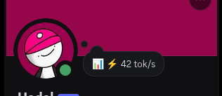
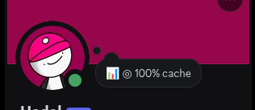

# hermes-discord-presence

Publishes live Hermes agent telemetry as your **Discord bot's presence** — the
same numbers the desktop app shows in its bottom status bar, visible to everyone
in the server without anyone having to ask.

## What it looks like

Real captures of the status rotating through its metrics (Custom Status, green
presence dot while the agent works):

| State | Screenshot | Config |
|---|---|---|
| Thinking — a request is in flight |  | default |
| Throughput |  | `show_tokens_per_second` (default on) |
| Cache hit rate |  | `show_cache_hit` (default on) |
| Active model |  | `show_model` (opt-in) |

Out of the box the status carries the three headline metrics — tokens/sec,
cache hit, and context occupancy. The running tool and the active model are one
switch each: useful, but they cost status length (Discord caps a Custom Status at
128 characters), so they stay off until you ask. Every enabled segment cycles one
per update in `rotate` mode, or joins onto one line in `compact` mode:

```
📊 ⚡ 96 tok/s · ◎ 79% cache · ▰▰▱▱▱▱▱▱▱▰ · 2% ctx · ⧉ terminal · ☤ gpt-5.6
```

### Everything at once, on two lines

Discord draws a **custom status and one named activity at the same time**, and
the plugin can use both. Two switches:

```yaml
mode: full             # every metric on, short labels
activity_type: both    # a custom status AND a "Watching …" line
activity_kind: watching
```

Nothing gets dropped to fit 128 characters — the metrics split across the two
lines Discord already gives you:

```
📊 ⚡ 96/s · ◎ 79%                                      ← custom status
Watching ▰▰▰▰▰▱▱▱▱▱ 5% · ⧉ terminal · ☤ gpt-5.6 · Σ 1.2M ← activity
```

In `rotate` mode the split is different and arguably better: line one rotates one
metric per update, line two carries **all the others**, so a single tick shows
every metric — the numbers move between the lines instead of disappearing. A
metric never appears twice, and when there is nothing for the second line (one
metric enabled, or an idle session) only the custom status is published.

`activity_type: streaming` makes that second line a "Streaming …" with a
clickable link — set `activity_url` (Discord requires one for streaming; without
it the plugin quietly falls back to `playing`).

## Install

```bash
hermes plugins install kyssta-exe/hermes-discord-presence
hermes plugins enable discord-presence
```

Or drop the directory in by hand:

```bash
git clone https://github.com/kyssta-exe/hermes-discord-presence
cp -r hermes-discord-presence/discord-presence ~/.hermes/plugins/
hermes plugins enable discord-presence
```

Requires the Discord platform to be connected (`DISCORD_BOT_TOKEN` set and the
`discord-platform` plugin enabled) for the presence to publish. Without it the
plugin still loads — `/pulse`, the tool and the CLI all keep working, they just
have nowhere to show a status.

## What you get

| Surface | What it does |
|---|---|
| **Discord presence** | Rotating or compact custom status on the gateway's own bot client, plus a status dot that tracks the work — and, in `full`+`both`, every metric split across Discord's two lines |
| **`/pulse`** | Formatted telemetry report in any gateway session (Discord, Telegram, CLI) |
| **`agent_pulse` tool** | The model can report its own performance when you ask "how fast are you going?" |
| **`hermes discord-presence`** | `status` / `json` / `config` / `reset` from a shell |

### The four states, annotated

A rotation cycle, captured live from the member list:

**Thinking** — `📊 thinking...`


Shown the moment a provider request starts, before any usage numbers have come
back. It outranks the metrics on purpose: "I'm working" is more useful than a
stale throughput figure, and it means a bot is never silently blank mid-turn.
The green dot on the avatar is the **online** presence status.

**Throughput** — `📊 ⚡ 42 tok/s`


The ⚡ segment. `sum(output tokens) / sum(request durations)` over the last 12
requests — true throughput, not a mean of per-request ratios, which is why a
single slow request doesn't tank the number.

**Cache hit** — `📊 ◎ 100% cache`


The ◎ segment: `cache_read / prompt`, where `prompt = input + cache_read +
cache_write`. 100% means the whole prompt prefix was reused — input cost is at
its floor. If the window has zero cache reads this segment is **hidden**, not
shown as 0%, because no data is not the same thing as a bad cache.

**Active model** — `📊 step-5-preview:free`


The ☤ segment (`show_model`, opt-in): the last path segment of the active route,
so `openai/gpt-5.6` shows as `gpt-5.6`. Useful when a session can fall back
between models and you want to see which one actually answered.

### The metrics

| Glyph | Metric | Definition | Default |
|---|---|---|---|
| ⚡ | Tokens/sec | `sum(output tokens) / sum(request durations)` over a 12-request rolling window — true throughput, not a mean of per-request ratios | **on** |
| ◎ | Cache hit rate | `cache_read / prompt`, where `prompt = input + cache_read + cache_write` | **on** |
| ▰▱ | Context usage | last request's `prompt_tokens` ÷ the model's context length, with a block bar | **on** |
| ⧉ | Running tool | the tool executing right now | off |
| ☤ | Model | active route, last path segment only | off |
| ◷ | Latency | mean request duration | off |
| Σ | Lifetime tokens | session total | off |

Discord caps a custom status at 128 characters, so every extra segment competes
with the ones you actually asked for. The three defaults fit comfortably; turn
the rest on one at a time, and watch the length if you use `compact` mode. Or
skip the arithmetic: `mode: full` turns every one of them on with short labels
(`⚡ 96/s`, `◎ 79%`, `▰▰▰▱ 5%`) and, with `activity_type: both`, splits them
across both Discord lines.

All of it comes from documented plugin hooks — `post_api_request`,
`pre_tool_call`, `pre_llm_call`. No core internals, no monkey-patching, no
private agent attributes.

### The status dot

| State | When |
|---|---|
| 🟢 `online` | a turn or tool is live |
| 🟡 `idle` | no activity for `idle_after_seconds` (default 180s) |
| 🔴 `dnd` | context occupancy reaches `context_warn_percent` (default 80%) |

## Configuration

Every key lives at `plugins.entries.discord-presence.settings` in
`config.yaml`, or in the Desktop under **Settings → Plugins → Discord Presence**
(the manifest's `config_schema` renders the form automatically).

```yaml
plugins:
  entries:
    discord-presence:
      settings:
        mode: compact              # everything on one line instead of rotating
        activity_type: watching    # "Watching ⚡ 96 tok/s" instead of a custom status
        activity_kind: watching    # the second line's kind when activity_type: both
        activity_url: ""           # link for a streaming activity
        update_interval_seconds: 30
        show_model: false
        show_context_bar: true
        context_warn_percent: 90
        status_emoji: "🚀"
```

| Key | Type | Default | Meaning |
|---|---|---|---|
| `enabled` | bool | `true` | Publish the presence at all |
| `mode` | str | `rotate` | `rotate` = one segment per update; `compact` = all joined and trimmed; `full` = every metric at once with short labels |
| `activity_type` | str | `custom` | `custom`, `playing`, `watching`, `listening`, `competing`, `streaming`, or `both` (custom status **and** a named activity) |
| `activity_kind` | str | `watching` | The named line's kind when `activity_type` is `both` |
| `activity_url` | str | `""` | Link for a `streaming` activity (Discord requires one) |
| `update_interval_seconds` | int | `20` | Seconds between updates (10–600) |
| `status_emoji` | str | `📊` | Leading emoji |
| `idle_after_seconds` | int | `180` | Quiet period before the dot goes idle |
| `context_warn_percent` | int | `80` | Occupancy that switches the dot to dnd |
| `show_tokens_per_second` | bool | `true` | |
| `show_cache_hit` | bool | `true` | |
| `show_context` | bool | `true` | |
| `show_context_bar` | bool | `true` | |
| `show_tool` | bool | `false` | Running tool (off — costs status length) |
| `show_model` | bool | `false` | Active model (off — costs status length) |
| `show_latency` | bool | `false` | |
| `show_totals` | bool | `false` | |
| `bar_width` | int | `10` | Context bar cells (3–20) |
| `separator` | str | `· ` | Between segments in compact mode |

## Reading the numbers

- **Cache hit near 100%** — the prompt prefix is being reused; input cost is at
  its floor. A drop means the prefix changed: a model switch, context
  compression, a toolset change, or a mid-conversation system-prompt edit.
- **"no cached reads"** — the window contains zero cache reads. That is *no
  data*, not 0%. Some providers never report cache fields; for those the
  segment stays hidden rather than showing a misleading `0%`.
- **Tokens/sec is windowed** — read it as a trend over several updates, not
  per-tick. One long request reads low; a burst of short ones reads high.
- **Context % includes replayed reasoning** on reasoning models, so the last
  request's prompt can exceed the durable transcript.
- **Compression count is an estimate**, inferred from a >50% prompt-token drop
  between consecutive requests. It is labelled as an estimate everywhere it
  appears.

## Rate limits and safety

Discord allows roughly five presence updates per 20 seconds per session. The
default 20s interval sits well inside that, and the publisher **skips the REST
call entirely when neither the text nor the status dot changed** — an idle bot
sends almost nothing.

A two-line presence (`activity_type: both`) goes out as a raw op-3 gateway
payload, because `discord.py`'s `change_presence` accepts a single activity while
Discord's presence payload carries an array. If the socket cannot be addressed
the update degrades to one line instead of failing.

Every hook is observer-only: nothing rewrites a prompt, blocks a tool, or
overrides a built-in. The manifest declares **no capabilities**. A presence
failure is logged and swallowed; it cannot take the gateway down.

## Development

```bash
python -m pytest tests/ -q          # 131 unit tests, no Hermes needed

# The 16 end-to-end tests load the plugin through the real PluginManager.
# They need a HERMES_HOME with the plugin enabled:
export HERMES_HOME=/tmp/hx
mkdir -p $HERMES_HOME/plugins
cp -r discord-presence $HERMES_HOME/plugins/
hermes config set plugins.enabled '["discord-presence"]'
python -m pytest tests/ -q          # 147 total

hermes plugins doctor discord-presence      # discovery + register() smoke test
hermes plugins validate discord-presence    # the catalog admission gate
```

## Layout

```
plugin.yaml          manifest v2 + config_schema (20 keys)
pyproject.toml       PM dependency declaration (no runtime deps)
__init__.py          register(ctx): hooks, platform handler, tool, CLI, skill
metrics.py           thread-safe rolling window over hook payloads
config.py            settings resolution + the schema mirror
render.py            pure snapshot → strings (no discord import)
presence.py          the Discord publisher (discord imported lazily)
pulse_tool.py        agent_pulse tool handler
schemas.py           tool schema
skills/discord-presence/SKILL.md
```

`render.py` and `metrics.py` deliberately have no `discord` import, so the
number-crunching is unit-testable and `register()` works on a host where
discord.py was never installed. `render.py` owns the one-line rendering and the
two-line split (`render_statuses`); `presence.py` turns those strings into
discord.py activity objects — and, for a two-line presence, into the op-3
gateway payload `discord.py` itself cannot build.

## License

MIT
